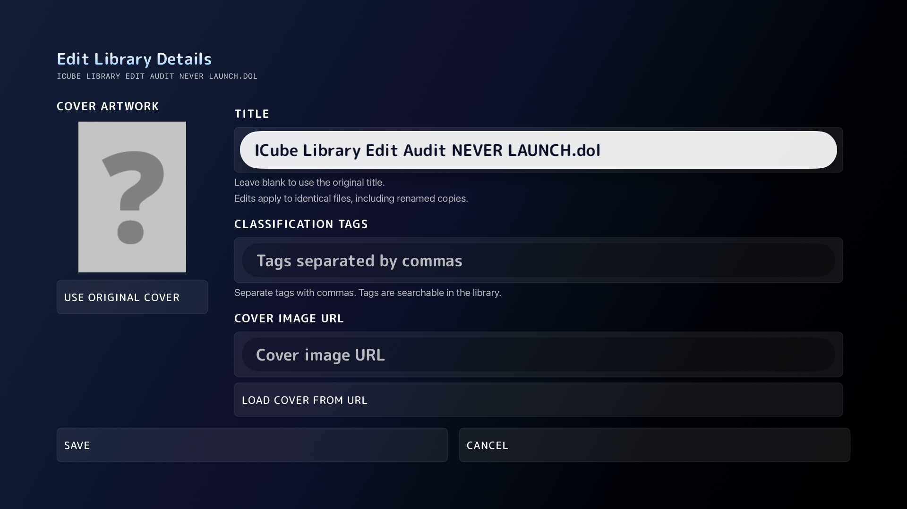

# tvOS library editor presentation — October 20, 2026

The owner identified an unusably narrow editor with overlapping content. Behavioral test passes had not established visual usability. A fullscreen-only experiment exposed another defect: globally transparent native Form/navigation surfaces let the library show through, while the default navigation title had poor contrast. That experiment is not accepted as a shipping presentation.

The tvOS editor now uses a fullscreen presentation with its own opaque iCube room, in-body header, fixed artwork column and separate scrolling fields. Field values use the existing 34-point title role; help/error text wraps at 21 points. Action buttons use the app's row chrome. Native field focus has no second scaling/glow overlay; empty prompts use the light-palette ink on the native light focus surface, and adaptive secondary text while unfocused. Save and Cancel remain outside scrolling content. Title is the preferred initial control, requested from the rendered view when identity becomes available; cover downloads do not re-run that identity task. The iOS Form and shared draft/persistence/cancellation logic are retained.

Integrated iOS and tvOS builds pass; the extracted iOS Form is byte-for-byte identical to the preceding version. Subsequent focus/prompt changes are tvOS-only. SwiftLint and the design/localization checks pass.

The first new-layout run passed Back (44.554s), selection (19.200s), cover save/reopen/clear (77.654s), oversized cover rejection (38.532s) and title/tags Save–Cancel–reopen–relaunch (102.835s), but **failed initial Title focus**. The passive preview focus stop was removed; default Title focus is requested from the rendered identity-dependent view. A later targeted run passed Back (44.796s), cover (82.211s) and presentation (26.213s).

Focused screenshots then exposed overlapping native/custom focus effects and faint empty prompts. Native fields now have static outer surfaces without the second scaling/glow effect. The bounded focused-prompt pixel regression **fails on the preceding installed build** (zero dark glyph samples) and **passes after the ink correction** (28.124s), including separate focused-empty Title, Tags and URL captures. All three final captures were inspected for text readability, overlap and clipping. These are targeted runs across revisions, not a claim that all six cases were rerun against the final color-only change. [Machine-readable run results and source hashes](2026-10-20-tvos-editor-results.json).

Other inspected captures: [focused Tags](2026-10-20-tvos-editor/tags-focused.png), [focused Cover URL](2026-10-20-tvos-editor/cover-url-focused.png). Physical-device/couch-distance review, other modal audits, real sync convergence and a new TestFlight upload remain open.

Required visual evidence includes opaque background, readable focused/unfocused text, no artwork/field overlap, fully visible Save/Cancel, remote traversal through all fields/actions, native keyboard dismissal and Back cancellation. Fixture imagery is intentionally a small magenta/black PNG and a non-executable library-only DOL marker; never launch that marker.

Other direct library sheets to inspect next: Search and Sources first, then source picker, save states, properties, toolbar menus, mods, cheats and cache details. Source inspection identifies risks only; do not call these reproduced defects or fix them without rendered evidence.
