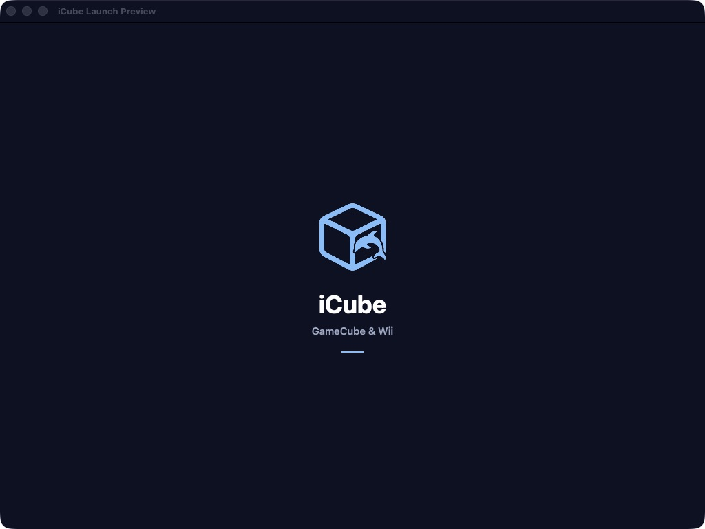
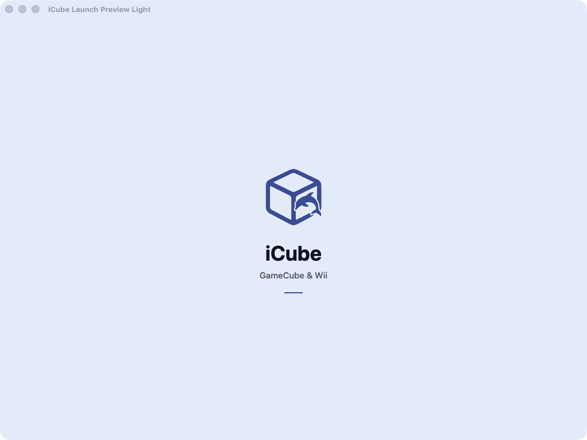

# Shared Plus, launch and library implementation — November 2, 2026

Implementation on isolated review branches, not merged or submitted to App Review.
Policy: [shared Plus](../../superpowers/specs/2026-11-02-shared-plus-policy-design.md).
Plan: [implementation checklist](../../superpowers/plans/2026-11-02-shared-plus-gates-and-launch.md).
The [original source audit](2026-11-02-shared-plus-gates-audit.md) is a historical
before-state; it does not describe all the fixes now present on these branches.

## Review branches and source changes

- iFly: [draft PR 908](https://github.com/JoeMatt/iFly/pull/908), commits
  `581e17e39d` / `a6631d00a4`. Imported shaders use a canonical import-root
  exemption; manual copies/Handoff are unmetered; four basic per-game settings
  entrances are free. Automatic library mirroring retains its existing Plus
  gate. Current paid benefit copy excludes newly free features. The one-time
  post-session prompt waits for settled ownership.
- Provenance: [draft PR 3787](https://github.com/Provenance-Emu/Provenance/pull/3787),
  commits `882c6ab41a` / `570e126e10`. Free save/progress sync has an effective
  runtime content scope that preserves the user's stored selection. ROM
  upload, asset and push paths consult effective scope. Practical audio,
  Require Password and Disable Auto Lock are accessible. Prompts move from
  launching to safe completed-session return and offer immediate dismissal and
  permanent opt-out. Existing cadence is retained rather than inventing a new
  approved schedule.
- iCube: branch `codex/icube-plus-boot`, commits `e38e3b7cb7` / `42f82e72f2`
  recognize existing sibling membership read-only and show status/restore
  guidance in iOS/tvOS About. `a6d21e0444` fixes library card sizing/zoom limits
  and removes duplicate toolbar-logo glass. `74fb1e8ec0` bundles GameCube Pocket
  and provides one-time offline installation without changing selected skins.
  The root launch integration calls the entitlement observer and seeds the skin
  only after user-folder setup. No new iCube product, buy screen or free-feature
  gate is introduced.

Existing recording/watermark, texture, Watch VMU, cosmetic/theme/icon/UI-mode
extras remain undecided and their gates were not changed. Existing free tvOS
and non-store behavior is preserved. Prices and StoreKit product setup were not
modified. No remote signing/provisioning changes or website deployment.

## Recognition scope and restore behavior

Both selling apps publish direct verified StoreKit ownership; a sibling grant
is not republished as an independent purchase. Readers validate subscription
expiry and lifetime payload shape, retain known legacy lifetime support and
existing seven-day renewal grace, and refresh with purchase/lifecycle changes.
iCube only reads the same-team keychain; it publishes no ownership claim.

Restore the qualifying purchase in Provenance or iFly **on each target device**,
then return to iCube on that device. The original seller's StoreKit restore can
supply the local shared mirror there, subject to that seller/product/platform
being supported. What is absent is automatic sibling-only restoration on a
new device without the selling app; no authenticated shared purchase backend
was introduced. Actual iOS/tvOS signed purchase/restore behavior remains to be
accepted. ROM pairing across different accounts does not grant Plus.

Lifetime refunds cannot be independently detected by a sibling while the seller
never refreshes its ownership. Subscription mirrors self-expire at the recorded
expiry plus existing grace. Do not market immediate global revocation or a
server-backed three-app subscription system from these local policy tests.

## Library fixes

The quick sizing buttons changed column offsets, but iOS cards retained fixed
140 x 210 frames. Grid/favorites now pass actual slot dimensions into the cover,
artwork and selection layers; tvOS and horizontal shelves retain their existing
default sizes. Offsets normalize at min/max boundaries, so reversing direction
no longer consumes invisible saved clicks. Controls visibly disable at limits.
The header logo no longer nests its own glass circle inside system toolbar glass.

Five native sizing/helper XCTest tests pass. Two boundary regressions were
observed failing before the fix. A real-card ImageRenderer hosted regression is
included but has not been executed against the full app module. Interactive
library zoom and actual iOS toolbar appearance remain app-host acceptance.

## Launch design and native proof

The actual iOS LaunchScreen storyboard replaces the oversized logo/tagline,
low-contrast static Loading label and footer credits with a compact mark,
wordmark, platform caption and adaptive room colors. Credits remain in About.
There is no extra startup timer, fake progress or new SwiftUI splash screen.

The storyboard compiles with ibtool without warnings/notices/errors. Its assets
compile for iOS Simulator and UIKit Mac Catalyst. A small UIKit Catalyst app
loads that compiled storyboard and native window captures confirm both themes:

UIKit layout evaluation at phone portrait, phone landscape, small 568 x 320
landscape, iPad portrait and iPad landscape reports zero ambiguous views. See
[layout measurements](2026-11-02-launch/layout-results.txt). These are UIKit
geometry tests/native Catalyst previews, not screenshots of a newly installed
shipping iOS/tvOS build. Raw CALayer snapshots lose template-image tint; the
native window captures above verify the actual composited mark and colors.

A fresh isolated iOS simulator create command stalled without creating a device;
only that command was interrupted. No simulator was reset, no existing shared
simulator/device was used, and the original stuck iPad simulator was untouched.
The UIKit Catalyst preview provides a fast native layout check despite that host
issue. Temporary preview apps were closed after capture.

## GameCube Pocket

The GameCube Pocket archive by starvingartist is bundled free with
source, author credit, permission notice and SHA-256 in BundledSkins/CREDITS.txt.
Actual SkinKit decoding finds both iPhone orientations; both 14-item layouts
fit, all button/stick/action names map to iCube, and skin artwork stays separate
from the app code licence. No games/ROMs are bundled.

CI run 41563021395 exposed two missing-menu-art assertions: the original archive
references `menu.pdf` in both orientations but omits that file. The bundled copy
now adds an iCube-authored vector menu glyph, preserving every original entry.
CREDITS records both hashes and the repair; asset assertions remain enabled.

The bootstrap seeds it once after user-folder setup, with no network fetch and
no selection changes. A completed seed marker preserves intentional deletion;
existing same-ID imports are not replaced. Historical explicit None is
indistinguishable from an untouched selection, so it is available offline in
the picker rather than automatically selected. iPad/Wii/TV controls are not
replaced.

Actual-source SkinKit model/layout/input and bootstrap lifecycle host harnesses
pass. Five archive/migration XCTest regressions were added but remain unrun in
the app host. Playability and portrait/landscape transitions still need actual
installed-app acceptance before declaring it the default skin.

## Validation summary and remaining gates

- Provenance production PVSettings: 278 tests in 39 suites pass; focused runtime
  scope + support schedule harness: eight tests in two suites pass.
- iFly focused production-source shader/pull policy and route checks pass,
  including observed pre-fix failures. Parsing, formatting and targeted native
  typechecks pass. Full app tests stop at missing libevmu submodule in the
  isolated checkout; make quick also lacks eslint. These were not waived as
  full-app passes.
- Three-app native source reader harnesses: 19 assertions pass; focused
  StoreKit/Security typechecks pass. iCube's facade also typechecks against the
  actual iOS Simulator SDK, and launch/skin integration parses against that SDK.
- iCube library helpers: five native XCTest cases pass; iOS/tvOS parsing passes.
- Storyboard/assets compile; native dark/light windows and five layout profiles
  inspected. Independent source review covers gate, ownership, scope, prompt,
  library, launch and skin changes with no confirmed actionable finding.
- Existing CloudKit lint debt remains; no full iOS/tvOS application build,
  installed StoreKit restore/refund test or live CloudKit convergence proof is
  claimed. Legacy iCloud Drive behavior is preserved and is not represented as
  newly comprehensive paid-automation enforcement. Already admitted transfers
  are not retroactively canceled.

Before merge/release: run the complete app/CI checks, installed unpaid/paid/lapsed
flows, actual shared-group signing and restore on each supported platform,
CloudKit save protection, library sizing/header appearance, skin transitions,
and prior outstanding hardware/library-sync release gates. Neither iCube
platform has been submitted for review. Existing content-rights and storefront
choices are not changed by this engineering branch.
